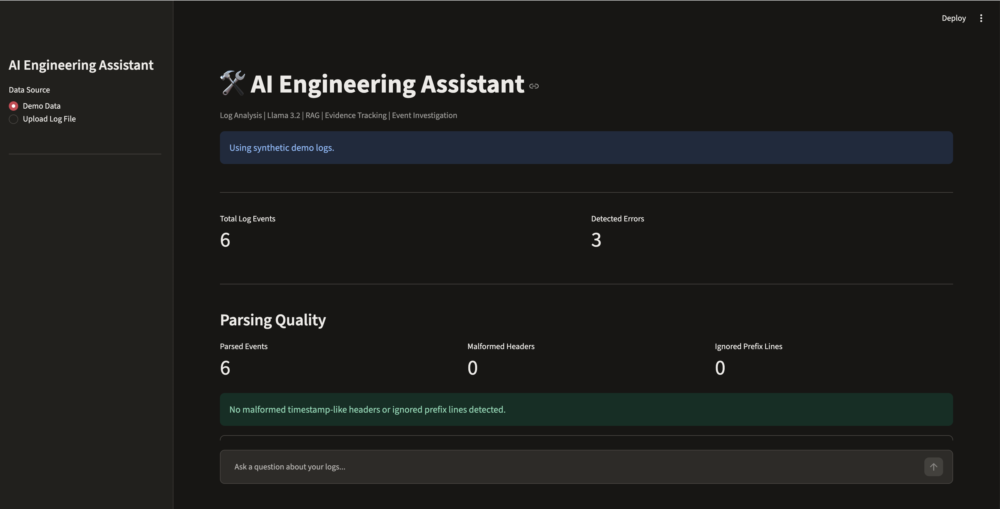
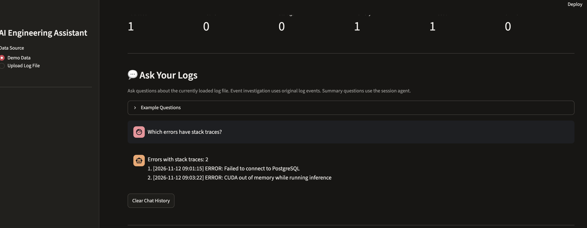
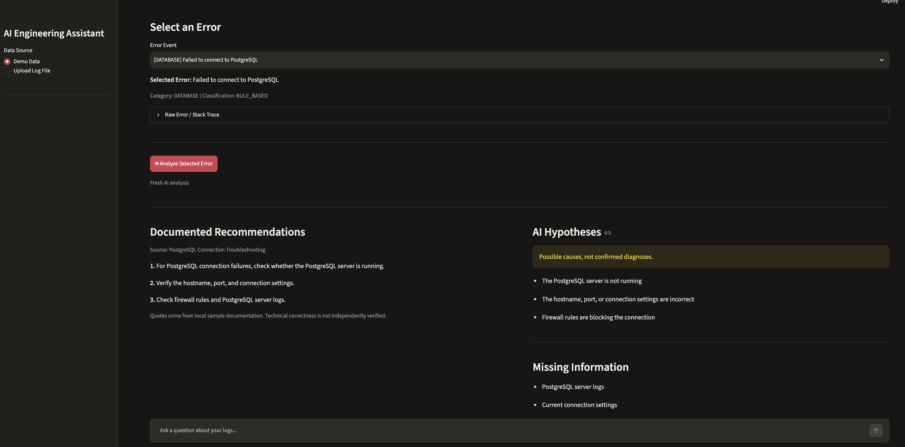

# AI Engineering Assistant

A local AI-powered log analysis and investigation assistant built with Python, Ollama, Retrieval-Augmented Generation (RAG), and Streamlit.

The system helps developers analyze application logs, identify error categories, investigate event sequences, and retrieve relevant troubleshooting guidance.

## Features

- Parse structured and multiline application logs
- Detect ERROR, CRITICAL, and FATAL events
- Classify errors into DATABASE, NETWORK, MEMORY, STORAGE, TIMEOUT, and UNKNOWN
- Use a local LLM for classification and question intent detection
- Retrieve relevant troubleshooting documentation with semantic search
- Separate documented guidance from unverified AI-generated hypotheses
- Investigate event order and detect stack traces
- Upload log files and explore errors through an interactive dashboard
- Ask questions about the currently loaded log session
- Detect malformed log headers and report parsing quality
- Export individual error analyses as JSON

## Technology Stack

| Technology | Purpose |
|---|---|
| Python | Core application and log processing |
| Ollama | Local LLM inference |
| Llama 3.2 | Error classification and intent detection |
| nomic-embed-text | Semantic embeddings |
| RAG | Documentation retrieval |
| Streamlit | Interactive dashboard |
| Git | Version control |

## Architecture

```text
Log File
    |
    v
Log Parser
    |
    v
Error Extraction
    |
    v
Rule-Based / AI Classification
    |
    +------------------------------+
    |                              |
    v                              v
Evidence-Aware Analysis      Session Agent
    |                              |
    v                              v
Semantic Retrieval           Error Summaries
    |                         Event Investigation
    v                         Intent Detection
Local Knowledge Base              |
    |                              |
    +---------------+--------------+
                    |
                    v
             Streamlit Dashboard
```

The application combines deterministic Python processing with local AI components.

Error counts and event ordering are calculated directly from the parsed data rather than generated by the language model.

## Installation

### 1. Clone the repository

```bash
git clone <repository-url>
cd aiEngineeringAssistant
```

### 2. Create a virtual environment

```bash
python -m venv .venv
source .venv/bin/activate
```

### 3. Install Python dependencies

```bash
pip install -r requirements.txt
```

### 4. Install Ollama and download models

Install Ollama separately, then run:

```bash
ollama pull llama3.2
ollama pull nomic-embed-text
```

Ensure Ollama is running before using the AI features.

### 5. Launch the dashboard

```bash
python -m streamlit run dashboard.py
```

## Example Questions

The dashboard currently supports predefined patterns of log investigation questions, including:

- How many errors are in this file?
- What is the most common error category?
- How should I investigate the most common errors?
- Which error happened first?
- Which errors have stack traces?
- What happened before the PostgreSQL failure?

The question interface is not yet a general-purpose conversational agent.

## Evaluation

The project was evaluated using synthetic log examples, classification regression cases, parser edge cases, and agent-routing scenarios.

| Evaluation | Passed | Total |
|---|---:|---:|
| Log parsing | 14 | 14 |
| Classification regression | 10 | 10 |
| Unseen synthetic classification | 12 | 12 |
| Agent tool selection | 4 | 4 |
| Advanced agent scenarios | 3 | 3 |
| **Total** | **43** | **43** |

All 43 checks passed in the latest reported evaluation run.

These results describe the specific test sets used. They do not establish production accuracy or generalization to arbitrary real-world logs.

## Reliability and Safety

The assistant includes several mechanisms intended to reduce unsupported conclusions:

- Deterministic calculations for error counts
- Separation of source-backed guidance and AI hypotheses
- Missing-information reporting
- Fallback behavior when documentation is unavailable
- File-order context that does not imply causation
- Parsing-quality indicators for malformed records

Local knowledge-base documents contain general sample troubleshooting guidance. Their presence does not confirm the root cause of a failure.

## Current Limitations

- Log parsing supports a defined set of timestamp and record formats
- Question routing supports selected patterns rather than arbitrary queries
- Some error categories do not have matching local documentation
- AI classifications and troubleshooting hypotheses require verification
- Evaluation has primarily used synthetic examples
- No production deployment, authentication, or multi-user storage

## Future Improvements

- Broader natural-language query support
- Expanded technical documentation
- Additional real-world log datasets
- More comprehensive evaluation metrics
- Improved root-cause investigation workflows

## Project Status

Local portfolio prototype. Core dashboard, error classification, documentation retrieval, event investigation, and initial evaluation are implemented.


## Screenshots

### Dashboard Overview


### Event Investigation


### Evidence-Aware AI Analysis

